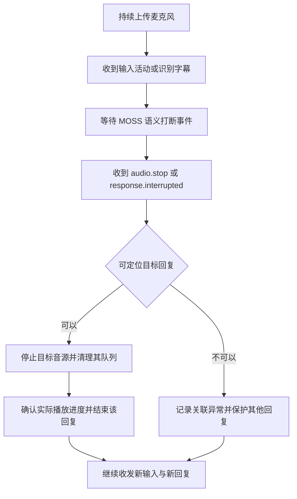

# MOSS Live 独立实时语音插件开发文档

## 文档状态

Confirmed / current-Bot MOSS sidebar, Profile voice settings, captions and Profile memory implemented; client interruption handling is implemented and verified, while real MOSS silent-wait result playback remains incomplete

2026-11-17 文档补充：用户要求整理待补齐内容，新增[第 15 节：打断与任务结果播报协议补齐](#15-打断与任务结果播报协议补齐开发草案)。用户随后要求“按照文档开始开发”，本节已确认并进入实施；保留已有功能基线及未纳入范围的候选方案。

2026-11-17 开发进展：MLF-01～03 已实施。客户端现在按回复隔离清理音频，处理 `response.audio.stop` 和 `response.interrupted`，过滤迟到分片并保护播放回执；补充兼容 MOSS 将缺少的 `turn_id` 序列化为空字符串的情况，并保持只在回复可唯一定位时发送有效停止回执。专项回归和真实 Desktop 插话诊断已通过。MLF-04 仍在排查真实 MOSS 主动播报的空播放标识。

2026-11-11 更新：用户已确认第 12 节接入界面与「当前私聊、忙碌排队、明确语音指令直接派发」方案，进入实施；独立 Worker 继续延期。

2026-11-13 更新：用户确认一个 Bot 对应一个 MOSS Profile，并确认人工启动/切换、离开 Bot 页面结束通话、C 双栏字幕、MOSS 侧栏语音控制和练习摘要主动保存规则。第 12 节和第 13 节中的多 Bot 接入卡片、跨页常驻通话和底部通话条保留为历史实现记录；当前产品设计以第 14 节为准。

2026-11-13 更新：用户进一步确认 MOSS Live 的主入口放在当前 Bot 详情侧栏；未绑定时侧栏提供“绑定 MOSS Live”和“MOSS Live 设置”，已绑定时自动显示 MOSS Live 侧栏，用户手动点击“拨打”。插件页暂不作为主入口；侧栏设置按钮打开统一弹框面板。

2026-11-13 更新：用户进一步指定 MOSS Live 设置入口位于 Bot 详情侧栏原有“详情 / 浏览器”页签位置，新增“MOSS Live”页签；点击后直接显示 MOSS Live 设置界面，绑定后的页签显示 Profile 状态和“拨打”入口。

2026-11-14 更新：用户确认音色按 MOSS Profile 独立设置；MOSS API 账号和 API Key 继续共享。已进入 Profile 配置、试听和按当前 Profile 启动会话的实现。

2026-11-14 实现修正：已绑定 Bot 的当前页面现在自动显示 MOSS Live 空闲侧栏；详情抽屉打开时暂时让出空间，关闭后恢复。空闲侧栏显示 Profile、音色、设置和“拨打”，拨打后在同一侧栏切换到字幕与通话控制；详情侧栏设置入口通过请求传递打开统一弹框。切换到另一个已绑定 Bot 时先结束旧通话，再显示目标 Profile 的空闲侧栏。

2026-11-14 用户确认新增 MOSS Profile 会话记忆，并澄清异步任务结果行为：用户没有挂断 MOSS，也没有继续说话，只是等待一段时间时，绑定 Bot 完成任务后仍必须在同一 MOSS 会话中主动播报结果。本项不改变挂断后不向新会话注入旧任务结果的边界。

2026-11-17 实施与验证：Profile 在最终字幕到达时保存检查点，挂断或异常断开时补结束时间；同一通话幂等更新。侧栏可查看会话记录、继续练习或开始新会话，恢复内容通过 Host 的 `session.thinking.append` 分片发送，不与业务指令混合。异步任务完成后，同一有效 MOSS 连接直接收到事实和 `session.commentary.append`，本地回归通过；真实主动播报仍未验收通过，见第 14.9 节。

2026-11-17 用户要求关闭“你好，我是 DS Bot”开场语音；已在正式 Host 保存当前配置 `greetingEnabled:false`。保留 MOSS 正常对话语音和 Profile 音色设置。

## 1. 目标与使用场景

用户在 DS Bot 插件页配置 MOSS Live，并从同一页面启动一个独立的全双工实时语音会话。麦克风音频进入 MOSS Live，实时字幕和语音回复回到插件面板。该会话不创建 DS Bot Bot 回合，不读取 Bot 工具、记忆、权限或审批。

以上为独立语音阶段的基线。现阶段按第 12 节扩展可选 DS Bot 接入：用户授权后可检索指定 Bot 私聊，或明确派发任务并创建该 Bot 的普通回合；MOSS 实时会话本身仍独立存在。

## 2. 当前行为

- `[代码证据]` `moss-live` Demo 使用本地 FastAPI 中继连接 `wss://api.mosi.cn/v1/realtime`，API Key 只放在上游 WebSocket 握手头。
- `[代码证据]` MOSS Live 当前协议支持 Persona、Instructions、16 kHz 上行 PCM、48 kHz 下行 PCM、实时字幕和播放打断。
- `[代码证据]` DS Bot 已有 Node Host、插件设置页、Secret Store 和 `ws` 依赖，可承载 loopback 中继。

## 3. 期望行为

1. 用户在 MOSS Live 设置页填写 Persona、Instructions、模型 ID 和 API Key。
2. API Key 保存到 DS Bot Secret Store；状态只显示是否已配置。
3. 用户启动会话后，Host 建立带认证的 loopback WebSocket 中继，并由客户端取得麦克风权限。
4. 客户端持续发送 16 kHz PCM，接收 48 kHz PCM，显示用户和 MOSS 的实时字幕，并支持 MOSS 的抢话停止。
5. 用户停止会话后，客户端、上游 WebSocket 和 Host 中继都被释放。

### 3.1 第一阶段（已确认）

- `[用户确认]` 2026-11-09：先完成光球动画、音量驱动状态、开场问候、场景预设和字幕记录导出。
- 光球只使用 DS Bot 内置 CSS 动画和实时音量数据，不复制示例项目的图片、音频或源码素材。
- 开场问候使用浏览器的系统语音；问候期间暂时静音麦克风，问候结束后恢复。
- 场景预设只修改当前配置草稿，用户点击“保存配置”后才持久化。
- 字幕增量按当前语音段合并，导出 Markdown 时只生成本地下载，不上传到 MOSS 或 DS Bot。

### 3.2 第二阶段（已确认）

- `[用户确认]` 2026-11-09：摄像头暂不启用，先加入屏幕共享。
- 用户在已启动的 MOSS Live 会话中主动点击“共享屏幕”，浏览器请求屏幕采集权限。
- 获得权限后，插件显示当前屏幕预览，并以限频 JPEG 帧发送给 MOSS；停止共享、会话停止或系统结束共享时释放轨道和预览。
- 屏幕共享默认关闭，不保存屏幕图像；摄像头控制不出现在本阶段页面。
- `[代码证据]` Windows Desktop 使用 Electron 采集处理器和现有应用卡片选择整块屏幕；不依赖 Windows 上不可用的浏览器系统选择器。取消或关闭页面不授予画面，系统声音不共享。

### 3.3 MOSS Live API 对齐（已完成）

- `[用户确认]` 2026-11-10：先完成 MOSS Live 官方 API 对齐，再进入 DS Bot delegation 桥接。
- `[代码证据]` Host 配置已支持 `conversation` / `interpret` 模式、音色 ID、源/目标语言、双向翻译、`standard` / `low` 媒体档位，以及视频长边、JPEG 质量和帧间隔。
- `[代码证据]` 同声传译模式使用 `/v1/realtime/interpret`，并携带 `source`、`target`、`bidirectional` 和可选 `voice` 参数；对话模式保留原 realtime endpoint。
- `[代码证据]` 客户端按 `session_attached → change_voice → voice_changed → session.update → media.mode → media.configure → media.configured` 顺序建立对话会话；同声传译跳过 `session.update`。
- `[代码证据]` Host 白名单新增 `change_voice` 和 `media.configure`，媒体参数仍由 Host 进行范围校验和清洗。

### 3.4 音色目录与试听（真实 API 与 Desktop 播放已验证）

- `[用户确认]` 2026-11-10：音色选择改为从 MOSS 账号可用音色列表同步，插件内支持选择和试听。
- `[代码证据]` Host 使用 `GET /v1/audio/voices` 分页读取 `id`、`name` 和创建时间；API Key 只在 Host 请求头中使用。
- `[代码证据]` 试听通过 Host 调用 `POST /v1/audio/speech`，使用短固定文本、`moss-tts-1.5-flash` 和 `delivery_method: audio` 接收 MP3，再以内存 data URL 交给播放器；浏览器不接触 API Key，音频不写入本地文件。此前 CDN URL 在浏览器请求时返回 403，现已消除该请求路径。
- `[用户确认]` 2026-11-10：音色目录只放在下拉框内，避免长列表影响后续配置展示。
- `[代码证据]` 插件页仅保留音色下拉框、一个“试听 / 停止试听”按钮和刷新按钮；生成期间显示状态，需要时显示播放器。切换音色、停止或离开页面会终止当前试听及迟到响应。
- `[代码证据]` 2026-11-11 “青年音”真实请求返回 HTTP 402 / `insufficient_credits`；试听属于语音合成调用，会按 MOSS 规则计费。页面已说明计费方式，并区分积分不足与通用计费拒绝；余额不足时不会自动重试，也不把音色标记为永久不可用。此前播放通过不代表当前账户仍有可用积分。

## 4. 已确认决策

- `[用户确认]` 2026-11-08：先采用方案 A，即独立 MOSS Live 实时会话。
- `[候选建议]` 首版继续作为现有 `ds-bot` 插件的内部模块，使用独立的 MOSS Live 设置页，不注册到通用 DSH Models provider 列表。
- `[用户确认]` 2026-11-09：摄像头暂不启用，第二阶段加入屏幕共享；直接文本输入仍留待协议验证。

## 5. 待确认问题

- `[现状重建]` 旧版 DS Bot 多 Bot 接入已实现桥接和任务回传，但未按第 14 节 Profile 绑定模型重构；这是下一阶段实施范围，不是当前未决产品行为。
- `[待确认]` 当前产品关系、页面结构、会话结束、字幕行为、控制位置、摘要保存和 Bot 删除策略均已由第 14 节确认；实现中出现超出第 14 节的范围时，需要重新确认。
- `moss-live` 仓库当前未发现 LICENSE/SPDX 声明；直接复制源码或素材前需要确认授权。该项属于授权检查，不改变本次 UI 和会话设计。

## 6. 功能范围

### 包含

- MOSS Live 模型 ID、Persona、Aliases、Prompt、Instructions、会话时长配置。
- DS Bot Secret Store 中的 `MOSS_API_KEY`。
- Host loopback WebSocket 中继、上游鉴权、指令白名单、二进制帧上限和会话时长上限。
- 麦克风 PCM 采集、实时字幕、48 kHz PCM 播放、播放回执和抢话停止。
- 用户主动开启的屏幕共享、JPEG 预览、屏幕视频帧（`0x02` 标签）发送和停止清理。
- MOSS 账号音色列表同步、音色选择和短样本试听。
- 插件页的启动、停止、状态、音量和字幕显示。

### 不包含

- 将 MOSS 实时会话注册为 DS Bot Bot/session 或通用模型路由；DS Bot 操作仅限第 12 节已确认的读取与派发范围。
- MOSS 直接文本输入、任意工具执行和摄像头输入。
- Android、离线运行、MOSS 源码或音频素材的直接复制。

## 7. 安全边界

- API Key 只在 Host Secret Store 和上游握手中出现，不进入 `state.json`、客户端配置或日志。
- 音色列表和试听请求由 Host 代持 API Key；试听只请求固定官方接口，禁止跟随重定向，检查音频类型和 2 MiB 大小上限后返回内存音频，不缓存 API Key 或音频文件。
- loopback 中继使用随机 token；只接受本机地址和当前会话 token。
- 上游地址固定为官方 realtime endpoint；客户端事件和 `session.update` 字段按白名单清洗。
- 单帧、单条消息和单次会话时长有上限；停止、错误和插件卸载都关闭上游连接。
- Desktop 屏幕采集只接受当前 DS Bot 主窗口主框架、同一 Host origin 且有用户点击的纯视频请求；Bot 浏览器分区仍拒绝屏幕采集。授权完成后才向 MOSS 声明屏幕开启。

## 8. 技术方案

- `ds-bot/src/host/moss-live.js`：配置规范化、Secret Store 接线、loopback 中继和上游 WebSocket。
- `ds-bot/src/client/moss-live.js`：AudioWorklet 麦克风采集、PCM 播放队列、字幕事件、`getDisplayMedia` 屏幕采集、JPEG 限频和 `0x02` 视频帧发送。
- `ds-bot/src/client/plugin-page.js`：配置与实时会话面板。
- `ds-bot/src/host/channel.js`、`ds-bot/src/client/index.js`：Host actions 和插件页注册。
- `app/src/main.mjs`：Windows `getDisplayMedia` 处理器、屏幕选择卡片、origin 和主框架检查。

## 9. 验收标准

- 未配置 API Key 时，启动按钮不可用，Host 不建立上游连接。
- API Key 不出现在 `mossLive()` 返回值、状态接口、页面文本和诊断输出中。
- 配置保存后，重载插件仍保留模型和 Persona 配置。
- 会话启动后完成 loopback 认证、上游连接和 `attach_session`；对话模式按音色切换、`session.update`、`media.mode`、`media.configure`、`media.configured` 顺序，同声传译模式跳过 `session.update`。
- 麦克风帧带 `0x00` 音频标签；下行音频能按 `response.audio.context` 配对播放。
- 上游发出 `response.audio.stop` 时，本地播放停止并回传 `playback.stopped`。
- 停止或错误后无旧 WebSocket、麦克风轨道或播放队列残留。
- 第一阶段页面显示光球舞台，并随输入或播放音量变化；会话状态可见 `ready`、`listening`、`thinking`、`speaking` 和 `greeting`。
- 第一阶段配置支持开场问候开关和文本，问候期间麦克风静音，问候结束后恢复。
- 第二阶段默认不申请屏幕权限；启动 MOSS Live 后点击“共享屏幕”才申请权限，页面显示预览和“停止共享”。摄像头按钮不存在。
- 屏幕帧使用 `0x02` 标签且不超过 Host 单帧上限；停止共享、系统结束共享和会话停止后没有残留媒体轨道或预览流。
- 场景预设能更新配置草稿；保存后重载仍保留指令。
- 实时字幕增量不会重复堆叠，存在字幕时可以下载 Markdown 记录。
- 单元测试、客户端构建和 lint 通过；真实 MOSS Key 下完成一次 Desktop 麦克风和扬声器 smoke test。

## 10. 当前实现状态

- `[代码证据]` 已完成 Host 配置、Secret Store action、loopback relay、MOSS 协议清洗、客户端会话、麦克风采集、PCM 播放、字幕、动画舞台、开场问候、场景预设、Markdown 导出和插件页入口。
- `[代码证据]` API 对齐已完成：配置页可设置模式、音色、语言和媒体档位；客户端等待音色和媒体配置确认后才进入 `ready`，屏幕采集参数跟随配置。
- `[代码证据]` 音色目录和试听已接入 Host actions 与插件页；2026-11-10 已使用现有真实账号完成列表查询、官方 MP3 二进制返回与 Desktop 插件按钮播放验收。播放器可解码并推进时间，显示“停止试听”，无页面错误；1000 个音色只占一个下拉框，常态选择区域约 79 px。
- `[代码证据]` 修复音频 src 同时由 React 属性和命令式赋值导致播放被重载中断的问题；回归覆盖音源仅设置一次、单个试听按钮和错误音频拒绝。MOSS 专项 62 项通过；全量 1766 通过、1 跳过、0 失败，构建与 lint 通过（既有警告）。
- `[代码证据]` 2026-11-10 补齐此前遗漏的 `/api/bot` 音色列表与试听路由，修复 `Unknown endpoint moss-live-voices`；新增经过真实 channel 注册入口的 3 项回归测试。MOSS/插件专项 61 项、全量 1765 项通过，1 项跳过。
- `[代码证据]` MOSS Live 与插件页专项测试 53 项通过，客户端构建检查通过；真实 Desktop 页面已验证 `ready`、`speaking`、字幕和停止流程。
- `[代码证据]` 第二阶段已完成客户端屏幕采集、预览、JPEG 限频、`video.state` / `video.stream_focus` 和 `0x02` 视频帧发送；新增客户端与插件测试通过。真实 Desktop 屏幕共享验收尚未完成。
- `[代码证据]` 2026-11-10 已尝试真实 Desktop 验收；Windows 画面捕获连续返回 `FrameArrived` 超时，无法继续进行 UI 点击和系统共享选择，因此没有把该次尝试记为真实屏幕共享通过。
- `[代码证据]` 2026-11-10 已修复用户截图中的 `Not supported`：补齐 Electron 主进程屏幕采集处理器，兼容 `securityOrigin` 尾斜杠；同时修复共享状态、关闭连接后的资源释放、迟到流和隐藏预览。真实 Electron 44.7.0 隔离测试使用测试页面自身成功生成 2 帧 JPEG，并确认轨道、预览和定时器释放；尚未将真实桌面内容发给 MOSS 验收。
- `[代码证据]` 2026-11-10 用户再次反馈 `Not supported` 后，放宽 Electron 请求兼容性：`audioRequested` 缺失时仍允许屏幕选择，但 `audioRequested === true` 仍拒绝；新增回归测试，源码 Desktop 已重启。

## 11. 继续入口

用户已启用华子/才子并用真人语音完成查询与派发，试用发现的连接恢复、结果回传和字幕异常已按第 12.10 节修复。当前由用户在更新后的 Desktop 复测结果播报、继续讲话与停止后重启；真实 MOSS 合成语音完整链路已通过。音色积分限制保留为历史记录，不以本次检查冒称受影响音色已恢复；摄像头、独立 Worker 与直接文本输入保持延期。

## 12. DS Bot 接入（已确认，实施中）

> 历史版本说明：本节记录 2026-11-11 至 2026-11-12 的多 Bot 接入实现和验收。其「一个 MOSS 接入多个 Bot」的产品模型已被新的 Profile 绑定模型取代；当前设计和后续实现以第 14 节为准。历史测试和异常记录仍保留，不能作为当前 UI 结构依据。

实现状态：代码与界面已完成；2026-11-12 修复真人试用发现的异常，95 项专项及真实 MOSS 合成语音完整链路通过；待用户复测，详见第 12.10 节。

### 12.1 已确认内容与目标

- `[用户确认]` 2026-11-11：保留独立 MOSS 语音前端，DS Bot 作为用户自行配置的可选接入对象；先实现操作现有 DS Bot，独立 Worker 暂不开发。
- `[用户确认]` 接入范围需要 UI，能配置允许连接的 Bot；读取上下文与执行任务分开。
- `[用户确认]` 上下文按需检索相关片段；不把全部历史预先塞入 MOSS，不使用另一个模型持续监视对话并分发任务。
- 本阶段目标闭环：配置接入范围 → 语音查询历史或提出任务 → Host 校验范围 → 查询片段或派发到指定 Bot → 显示真实状态并向当前 MOSS 会话反馈。
- `[用户确认]` 本节作为 ML-D01 中「不读取 Bot 上下文、不调用 Bot」的有限范围扩展；MOSS 实时会话本身仍不是 DS Bot Bot/session。

### 12.2 当前代码与可复用机制

- `[代码证据]` `src/host/moss-live.js` 的中继只转发媒体及受限配置，`session.update` 不接受工具；目前不存在 DS Bot 接入能力。
- `[代码证据]` `src/host/chat-index.js` 已有本地 SQLite 关键词检索、最近消息与来源锚点；`parts.js` 已有 Bot 私聊当前/历史分段和分页读取。读取这些数据不需要启动 Bot 模型。
- `[代码证据]` `channel.js` 的 `send` 使用 `ensureCapabilities` 和 `sessionController.prompt(mode: queue)` 向 Bot 当前私聊派发；不需要创建新的 Worker。
- `[代码证据]` `voice-bridge.js` 已有 `requestId → user/message.source.rpcId → turn` 的事件关联及排队消息定位，可复用其思路；它要求的主人声纹/唤醒验证不适用于 MOSS，不能伪造验证后借用该入口。
- `[代码证据]` `tools.js` 的 `message_bot` 要求调用者本身是团队 Bot。MOSS 不能伪装 Main Bot 绕过此限制；保留 Bot 现有的隐私、工具及审批机制。

### 12.3 界面依据（用户已确认）

在 MOSS Live 页面增加可折叠的「DS Bot 接入」卡片，初始关闭。Bot 多时在卡片内滚动并支持按名称查找，避免重复音色目录过长的问题。

```text
DS Bot 接入                                      [启用 □]
允许读取的对话片段及任务结果会发送给 MOSS。

查找 Bot [________________________]
Bot                      读取历史        派发任务
Chief                    [ □ ]           [ □ ]
才子                     [ □ ]           [ □ ]
其他现有 Bot …

历史范围：所选 Bot 的私聊（含历史分段）
任务位置：该 Bot 的当前私聊
发送方式：明确的语音任务指令直接派发，目标含糊时先询问
                                      [保存接入设置]

任务
Chief · 整理会议待办             排队中 / 执行中 / 已完成
可展开查看发给 Bot 的任务正文及附带上下文
简短结果或错误说明                      [打开 Bot]
```

- 每个 Bot 的「读取历史」「派发任务」独立保存，默认均关闭；只打开派发时，可返回本任务的状态和答复，但不能据此检索该 Bot 的其他对话。
- 私有 Bot 显示私有标识，默认不接入；若用户主动勾选，明确说明其允许的内容也会发给云端 MOSS。群聊、已删除 Bot 和私有归档不在首版范围。
- 无 Bot 时显示创建/前往 Bot 页的提示；已删除的授权对象显示失效，不按同名新 Bot 自动继承权限；保存失败保留草稿。
- 首版保存接入设置沿用现有配置保存后的停止会话行为，提示重新开始后生效；Host 每次读取、派发及回传前仍检查当前范围。
- 收起接入卡片不影响语音或任务状态；不在卡片外铺开完整 Bot 列表。

### 12.4 查询与执行流程（用户已确认）

**查询历史**

1. 用户说「查一下我和 Chief 昨天关于发布计划的讨论」。
2. MOSS 使用结构化调用指定 Bot、关键词、可选时间/分段条件；目标不明确时先澄清，不任意选 Bot。
3. Host 校验当前读取授权，仅在对应 Bot 私聊范围检索；本地过滤时间与分段，不另启动模型做路由或摘要。
4. 首次只返回最多 6 条相关片段、每条最多 600 个 Unicode 字符，附 Bot、时间和分段/消息锚点；截断或未找到时明确标注。用户明确追问时才能继续取相关内容。
5. MOSS 根据片段回答，页面保留来源和「打开 Bot」。查询本身不创建 Bot 回合，不产生任务，也不因历史内容中的指令自动执行操作。

**派发任务**

1. 用户说「让 Chief 把这些讨论整理成待办」。
2. MOSS 使用派发工具提交指定 Bot、完整任务正文及必要上下文；目标、任务或必要参数不清楚时先询问，不自行补全后执行。普通闲聊及只读查询不调用派发工具。
3. Host 校验用户已保存的派发范围和目标，将任务写入 Bot 当前私聊，忙碌时排队；快速回传本地任务 ID 和真实接收状态，页面显示任务卡，不让整段 Bot 工作一直占用上游工具调用。
4. MOSS 可以继续语音交谈。沿用该 Bot 已配置的工具、模型、工作目录及审批设置，不新增每次发送都要点击的审批流程，也不替代 Bot 执行过程中的现有审批。
5. 页面显示排队、执行、完成、失败或状态待核实；只有匹配本任务请求及实际回合的事件才用于更新结果，普通聊天回复不能冒充任务完成。
6. 实际完成后向仍有效的原 MOSS 会话发送简短结果（单次不超过 2000 个 Unicode 字符）；即使用户没有继续发话，也必须触发可听见的结果播报，并在字幕中留下结果。完整结果在 Bot 原对话查看。失败、需要用户操作或结果截断均如实显示，不把「已入队」说成「已完成」。

首版已派发任务通过「打开 Bot」进入现有停止/审批界面处理，不新增能停止其他工作的 MOSS 全局停止工具。「停止说话」只停止语音播放，不等于撤销任务。停止 MOSS 会话会丢弃尚未派发的请求及该会话的回传资格；已派发工作保留在 Bot，晚到结果不注入后续新 MOSS 会话。

### 12.5 技术方案与协议依据

- 官方依据：[MOSS Live API](https://platform.moss.cn/docs/reference/moss-live/)，2026-11-11 已读取：`session.update.session.tools`、`response.function_call_arguments.done`、工具结果确认、异步任务修订/取消、会话级 `session.commentary.append`。
- 首版使用固定的结构化工具定义：`dsbot_list_bots`、`dsbot_read_context`、`dsbot_submit_task`、`dsbot_task_status`。动态 Bot 名称及授权由工具结果提供，不动态拼接工具列表；不开放任意 DS Bot endpoint 或任意工具执行。
- Host 注册并执行这些固定工具。页面通过已有认证 channel 修改用户设置和查看状态，不能自行注入工具定义或伪造成功结果；同声传译不启用 DS Bot 操作。
- 原生 `delegation` 事件没有确定的目标 Bot 字段；本阶段保持其关闭，以结构化参数明确选中用户授权的 Bot。无需新建 Router 模型、Worker 服务或额外依赖。
- 可能超过约 2 秒的读取使用 `async_query`，任务派发使用 `async_effect`；严格按 `call_id` 去重，处理 `response.done` 中的重复调用。修订/取消只能替代或停止尚未派发的请求，不得借新版本自动重复发送已派发任务；已产生副作用的操作无法靠上游工具取消撤回，状态需如实回报。
- 工具结果通过 `conversation.item.create` 提交，收到相同 `call_id` 的 `conversation.item.created` 后才 `response.create`；初始化检查 `session.updated.data.error`，不在工具配置失败时宣称接入可用。
- 官方异步工具单次执行最长 120 秒；Bot 长任务不占据该等待周期。派发工具只等待入队回执，后续状态/结果使用允许省略 `delegation_id` 的会话级 `session.commentary.append`（`in_progress` / `completed` / `failed`），按 `event_id` 和本地任务 ID 关联并处理回执。
- 任务在本地跟踪请求、Bot、实际 session/turn 和原 MOSS 会话；不通过轮询模型判断是否完成。提交超时且不能确认是否入队时显示待核实，不自动再发。Host 重启后不自动重放旧任务；未证实的完成结果不得播报。
- 复用既有私聊检索及事件机制；如为时间/分段过滤增加内部读取参数，保持原有 `read_own_chat` 行为与权限不变。仅为当前 MOSS 接入增加一个范围受限的 Host 模块，不建设通用连接器框架。
- `[代码证据]` 本地派生聊天索引增加 audience 字段并升为 v4，用于仅返回用户私聊可见内容，排除隐藏的 Bot 间请求与答复；旧索引自动从原日志重建，不修改用户聊天。既有 `read_own_chat` 的检索范围保持不变。
- `[代码证据]` 麦克风帧等待工具/会话及媒体配置确认后才发送；本地浏览器连接被替换时重建结果回传绑定，避免旧任务结果进入后续会话。

### 12.6 安全边界与明确不做

- `[用户确认]` 独立 Worker 及持续后台对话分析本轮不做；摄像头延期约束不变。
- `[代码证据]` 保护对象是用户选中 Bot 的私聊与现有执行权限。MOSS 上游工具参数、历史内容和 Bot 输出均按外部数据处理；Host 按稳定 Bot ID 校验两类授权，不能只靠提示词限制。
- `[代码证据]` 只把授权的相关片段和本任务结果发送给 MOSS，不读取 Secret Store、Bot 系统提示或工作区文件来充当历史上下文。私聊片段可能包含用户资料，页面在授权处说明向 MOSS 分享的边界；不承诺自动识别片段中的全部敏感信息。
- `[代码证据]` 首版只包含私聊上下文查询、任务派发、状态及结果回传；不包含创建/删除/修改 Bot、群聊管理、任意文件读取或新的权限/审计体系。
- `[代码证据]` 对选中 Bot 的派发授权会启动该 Bot 原有能力，也可能触发其现有 Bot 间协作；本次接入选择限制的是 MOSS 的直接入口，不额外改变 Bot 原有的委派边界。
- `[代码证据]` 首版不增加离线通知、跨 MOSS 会话恢复或已派发任务的自动重试；正常断开后继续在原 Bot 对话查看工作。

### 12.7 产品决定确认记录

1. `[用户确认]` 任务沿用目标 Bot 的当前私聊，保留既有上下文，忙碌时排队；不新增独立任务会话。
2. `[用户确认]` 按 UI 中保存的派发授权，在用户明确语音下令时直接发送；目标含糊先询问，不增加逐次点击确认。
3. `[用户确认]` 用户回复「可以的」接受接入界面及上述交互，作为本次实现依据；设计确认不等于运行验收。

### 12.8 确认后的实施与验收

| 步骤 | 修改对象与内容 | 完成条件 |
|---|---|---|
| 1 | Host 接入配置/范围校验及插件接入卡片 | 保存、重载、空列表、失效 Bot、独立读取/派发开关均可观察；未授权 Bot 无法被调用 |
| 2 | 历史检索包装及 MOSS 固定工具协议 | 关键词、时间、分段和片段上限有效；无结果有明确提示；查询不产生 Bot 模型调用 |
| 3 | 结构化任务派发及现有 prompt 入队 | 未授权不发送，重复工具事件只发送一次；忙碌时显示排队，不抢占原工作 |
| 4 | 任务事件关联、页面状态及结果回传 | 请求对应正确回合；普通回复不串入；超过 120 秒的 Bot 任务仍能在实际完成后回传；原会话断开后无跨会话播报 |
| 5 | 错误和回归验证 | 授权撤销、目标删除、提交结果不明、工具修订/取消、迟到结果有测试；既有音频、音色、字幕、屏幕共享无回归 |

测试计划：先增加 Host/协议和 UI 行为回归，再执行 MOSS/插件专项、构建及 lint；有真实 MOSS Key 和测试 Bot 时，以「读一段已知历史 → 语音派发一项无外部副作用的任务 → 收到该任务结果」完成 Desktop 验收，不用对外发送消息或文件删除作为烟测任务。

回滚方式：关闭 DS Bot 接入后恢复独立语音体验；不删除 Bot 原聊天及已派发工作。关联模块决策：ML-D09、ML-D10。

### 12.9 实际验收记录（2026-11-11）

- MOSS/插件专项 83 项通过，覆盖读取/派发隔离、范围撤销、重复调用/回执、RPC 状态不明、工具取消、分段切换、混合回合和晚到结果隔离。
- 全量 1787 通过、1 跳过、0 失败；构建及 lint 通过（仅既有警告）。
- 真实 Desktop 界面显示 3 个现有 Bot 的独立读取/派发开关，默认关闭；宽屏卡片 860 px，430 px 视口下卡片 293 px，无横向溢出。已检查宽屏和窄屏截图。
- 使用已配置 Key，经真实 Host 中继完成 `session_attached → session.update → session.updated`；官方 API 确认四个固定 DS Bot 工具，配置无错误。该检查使用空授权列表，无麦克风输入，未上传用户历史或向用户 Bot 派发测试任务；结束后恢复原接入设置并关闭测试会话。
- 真人语音发起查询、任务执行和 MOSS 最终播报尚未验收，不用协议初始化成功替代完整链路验收。

### 12.10 会话恢复、结果回传和字幕异常修复（2026-11-12）

用户已用真人语音查询华子历史并派发天气任务，随后反馈会话停止、重启后无法回复，以及字幕显示异常。本轮按既有确认范围修复，不增加接入对象或执行权限。

- 已核对用户本次任务的持久记录：华子实际完成了天气查询，未重新派发该真实任务。回放发现自动注入的 `time-context` 被当作另一条用户输入，导致结果误标「需核对」；现在只把实际用户/团队消息用于混合输入判断。
- 真实 API 复现：同一上游 WebSocket 第二次发送 `attach_session` 会返回 `invalid_public_request / invalid or unsupported request`。开始会话现先清理旧客户端与 Host，再新建连接；本地客户端断开即关闭上游，已停止中继可重新启动，避免占用实时连接额度。
- 连接结束会释放麦克风、屏幕采集和播放资源；旧连接事件不能改写新会话状态。开场问候不可用或播放失败时也恢复麦克风，不再永久静音。可恢复的单条请求错误不再直接把整段语音标为停止。
- 补齐 `playback.completed`：收到 `response.audio.done` 且对应音频实际播完后，每个 `run_id / turn_id` 只确认一次。无有效回复标识时不发送停止回执，避免构造不受支持的请求。
- 字幕按回复的两个标识关联；输入最终文本补上 turn 时合并已有临时条目；支持 `input.transcript.revised` 修正已确认文本，避免覆盖其他话轮或重复条目。
- 任务回执提供与状态工具一致的 `task_id`；当前语音会话内可将 MOSS 的异步任务 ID 解析到同一任务。结果由 `session.thinking.append` 写入事实上下文，并立即通过 `session.commentary.append` 进入用户可听播报；事实回执只确认上下文写入，不作为播报门槛；两类回执均按真实返回的 `client_event_id` 关联。
- `[代码证据]` 当前任务回传链在同一 MOSS 会话中发送 `session.thinking.append` 记录事实，并立即发送 `session.commentary.append` 请求主动播报；`session.thinking.appended` 只确认事实上下文。自动回归覆盖静默等待三分钟后仍能回传；收到 append 回执不能作为音频已播出的证据。真实 MOSS 端的异常和验收边界见第 14.9 节。
- 专项 95 项通过；全量 1799 通过、1 跳过、0 失败；构建与 lint 通过（仅既有警告）。新增用例均先复现失败再修复。
- 真实 MOSS API 使用本机生成的中文合成语音完成「查询模拟历史 → 派发一项模拟天气任务 → 播报返回的天气内容 → 继续回答七加八」；只派发一次、无协议错误，结束时处于 ready。执行端为模拟 Bot，输入和天气均为测试数据，未以此冒称真人麦克风或真实 Bot 的整链路验收。
- 更新后的 Desktop 实测客户端关闭后 Host 变为 stopped；再次开始产生新的 token 并成功完成官方四工具配置，没有复用旧上游会话。宽屏/窄屏接入面板正常，用户原 Bot 授权在诊断后恢复。

<a id="moss-persistent-session"></a>

## 13. 跨页面常驻通话（A 已实现，待真人验收）

> 历史版本说明：本节记录旧的跨页面常驻通话和 A 底部通话条实现。用户已确认离开当前 Bot 页面结束 MOSS 通话，并移除全局底部语音条；本节保留为历史实现和回归依据，当前交互以第 14 节为准。

状态：`ACCEPTANCE`。用户先接受常驻交互并要求看显示效果，2026-11-12 再回复「那就 A 吧」，确认底部通话条及其原型中的静音、返回、结束、共享停止交互。A 的正式代码与自动验证已完成，真人麦克风和官方 MOSS 的本次改造后验收仍待进行；B/C 保留为探索记录。

### 13.1 已确认交互

- 切到 Bot 私聊或其他 DS Bot 页面时保留同一个 MOSS 语音会话；返回插件页恢复已有字幕、静音及共享状态，不重新连接或播放开场问候。
- 持续提供通话状态、静音、返回和结束操作；共享屏幕时保持共享提示与停止共享入口。
- 明确结束、禁用插件或退出应用时停止语音会话，释放麦克风、播放、屏幕采集和连接资源。切换页面不等于结束会话。
- 保留既有 DS Bot 授权边界、任务所属原 MOSS 会话的约束；本次不扩展 Bot 操作范围。

### 13.2 视觉候选与当前交付

原型入口：[三版对比](../../prototypes/cross-module/moss-live-persistent-session/index.html)。

| 候选 | 显示位置 | 说明 |
|---|---|---|
| A 底部通话条（用户已选） | 主区域底部，聊天输入框下方 | 独占约 68 px 高度，不遮盖聊天与输入 |
| B 悬浮胶囊 | 主区域右上角 | 可收起字幕；正式布局需处理遮挡风险 |
| C 侧栏通话卡 | Bot 侧栏底部 | 主聊天区完整；窄窗口改为底部控制 |

三版沿用 DS Bot 当前主题与角色资产，均提供模拟切页、静音、返回字幕、共享状态和结束操作。顶部预览状态切换不是正式产品 UI；原型不访问真实 Bot、麦克风、屏幕或模型。

### 13.3 实施与验收边界

- `[用户确认]` 采用 A；桌面显示状态、时长、静音、返回和结束，共享时显示停止共享；窄窗口压缩为带可访问名称的图标操作。
- `[代码证据]` 改造前 `MossLiveSettings` 持有会话且卸载时停止。实现采用客户端根控制器持有媒体、连接、字幕、静音和问候，页面仅订阅；不把配置草稿或 API Key 放入常驻条。
- `[代码证据]` 已安装 DSH 的 `shell.bottom` 是跨页面根挂载位置，会为底部内容预留高度。复用它显示通话条，避免覆盖输入框；禁用插件、客户端根释放和 `pagehide` 回收资源。MOSS 页仍使用现有插件页入口。
- 验收包括切换 Bot 后同一连接继续、返回字幕与静音保留、停止共享不结束语音、结束/禁用/退出清理，以及启动或共享授权尚未返回时结束后不能恢复旧会话。
- 摄像头、独立 Worker、跨应用重启恢复和额外授权体系不包含在本次视觉评审内。

### 13.4 原型验证

三版桌面及 430 px 窄窗口渲染、导航保活模拟、静音保留、返回原字幕、停止共享、结束和新会话交互均通过。控制台错误 0，外部请求 0。详见[原型验证记录](../../prototypes/cross-module/moss-live-persistent-session/verification.md)。关联模块决策：ML-D11。

### 13.5 正式实现与验证（2026-11-12）

- 新增 `moss-live-controller.js` 作为当前客户端实例内唯一会话持有者，统一保留连接、字幕、媒体、静音、问候、时长与结束状态；设置页卸载仅清理其轮询、试听播放器和预览元素，不停止共享会话。
- 新增 `moss-live-bar.js`，经根 `shell.bottom` 挂载 A 通话条。使用现有主题和圆角档位，跟随侧栏宽度/窄窗口头像栏留白，不覆盖输入框。返回通过现有插件页导航与其已有导航 store 选中 MOSS Live 标签，不建立另一份页面或会话。
- 启动中途结束会使旧请求失效，晚到的 Host 启动和媒体授权会被回收；旧字幕/状态事件不能更新已结束或下一次会话。静音在媒体取得前就生效，问候期间收到 ready 事件也不会提前打开麦克风。
- 专项 106 项通过。构建和 lint 通过（lint 仅有既有警告）；全量结果记录在原型目录的[正式实现验证](../../prototypes/cross-module/moss-live-persistent-session/verification.md#正式实现验证)。
- 在独立数据目录启动真实 DSH Host 和生产客户端 bundle，以本机模拟 MOSS WebSocket、静音合成音轨及合成画布验证：离开设置页后原连接/音轨仍在；从常驻条返回原标签保留字幕及静音；返回未重复启动和申请麦克风；共享跨页面继续，停止共享只关闭屏幕轨道；结束关闭全部测试媒体。期间仅有 1 条 MOSS 测试连接、1 次麦克风请求，未调用官方 MOSS、未采集真实麦克风/桌面、未派发真实 Bot。
- 实际页面 1320×860 和 430×900 截图已检查。屏幕共享停止按钮和其余操作均在窄窗口内，身份信息未被侧栏遮挡，无横向溢出；正式通话条截图见验证记录。
- 已同步构建产物到 Desktop 安装副本。当前已运行的旧窗口未强制重载，以免中断用户通话或 Bot 工作；重启应用或重新加载窗口后使用新代码。

关联模块决策：ML-D12。

### 13.6 挂断后保留通话条与重新拨打（用户已确认）

- `[用户确认]` 用户补充「如果我挂断，我希望那个通话条还能在，让我重新拨打。」挂断后仍保留 A 通话条，状态显示「已挂断」，将结束操作换为「重新拨打」，仍可返回 MOSS 页。
- 挂断继续释放麦克风、屏幕采集、播放和连接；只保留界面与上一通字幕以便查看/导出。重新拨打使用已保存配置建立新的 MOSS 会话，清空旧会话字幕，不自动恢复屏幕共享，旧任务的迟到结果不得进入新通话。
- 禁用插件或释放客户端时隐藏通话条。结束清理尚未完成时禁止重新拨打；重复点击只能创建一通新会话。
- 本节替代初版「挂断即隐藏通话条」的显示行为，不改变释放资源或接入授权的约束。
- `[代码证据]` 已实现；专项 108 项通过，全量 1812 通过、1 跳过、0 失败，构建和 lint 通过（既有警告）。已用真实生产界面与本机模拟 MOSS 验证：挂断后条保留、全部测试媒体关闭，在 Bot 聊天页双击重新拨打仅建立第二通电话，不自动恢复屏幕共享，第二次挂断后仍可重拨；桌面和 430 px 显示已检查。真人官方 MOSS 复测待进行。

关联模块决策：ML-D13。

## 14. Profile 绑定与 DS Bot 当前页面字幕界面（已确认，已实施，待真人验收）

本节是 2026-11-13 用户确认后的当前设计基线，取代第 12 节的多 Bot 接入 UI 和第 13 节的跨页常驻通话 UI。Profile 绑定、独立音色配置、Bot 详情侧栏入口和实时字幕已进入正式实现；正式 Desktop 重启后的真人验收仍待完成。旧章节保留历史代码、测试和回归证据，不再作为新实现的结构依据。

### 14.1 产品关系与会话边界

- `[用户确认]` 一个 DS Bot 只能绑定一个 MOSS Profile；一个 MOSS Profile 只能绑定一个 DS Bot。MOSS API 账号和 API Key 可以由多个 Profile 共用。
- `[用户确认]` 第一阶段采用人工启动和人工切换，不开发唤醒词。
- `[用户确认]` MOSS 通话属于当前 Bot 页面。用户离开当前 Bot 页面时，结束当前 MOSS 通话并释放麦克风、播放、屏幕共享和上游连接。
- `[用户确认]` 通话中切换 Bot 时，先结束当前通话，再选中目标 Bot；不暂停旧通话，不自动把新通话转移到目标 Bot。
- `[用户确认]` 音色属于 MOSS Profile 独立配置；多个 Profile 可以使用不同音色，试听针对当前 Profile。MOSS API 账号和 API Key 仍为公共配置。
- `[代码证据]` 现有 Bot 读取历史、任务派发、审批和 Host 权限边界继续沿用；本轮只改变 Profile 归属和界面入口，不扩大 MOSS 的直接权限。

### 14.2 当前 DS Bot 页面布局

- `[用户确认]` 使用 DS Bot 当前页面作为基础：左侧 Bot 列表、中间当前 Bot 私聊、底部输入区。
- `[用户确认]` C 双栏字幕作为正式方向：中间保留 Bot 聊天，右侧提供 MOSS 实时字幕面板。
- `[用户确认]` MOSS 面板不重复显示 Bot/MOSS 配对行。Bot 与 Profile 关系由左侧 Bot 列表、聊天标题和 Profile 信息展示。
- `[用户确认]` 不显示全局底部语音条。静音、返回 MOSS、挂断、重新拨打和屏幕共享停止均放在 MOSS 侧栏内。
- `[用户确认]` 离开当前 Bot 页面后通话结束，因此不要求在其他 Bot 页面继续显示 MOSS 控制条。
- `[代码证据]` 当前页面融合低保真稿位于 [c-integrated-current-page.html](../../prototypes/cross-module/moss-live-transcript-stage/c-integrated-current-page.html)，已按 `start.ps1` 启动后的 Chief/华子/才子列表、华子聊天和输入区重建。

### 14.2.1 MOSS Live 入口、绑定与设置面板

- `[用户确认]` MOSS Live 的主入口放在当前 Bot 的详情侧栏；当前 Bot 详情侧栏中的其他信息和操作继续保留。
- `[用户确认]` 未绑定 MOSS Profile 时，侧栏同时显示“绑定 MOSS Live”和“MOSS Live 设置”。两者都打开同一个弹框面板；弹框内可以完成 Profile 绑定和 MOSS Live 配置。
- `[用户确认]` 已绑定 MOSS Profile 时，当前 Bot 页面自动显示 MOSS Live 侧栏；通话仍由用户手动点击“拨打”开始，不自动申请麦克风或建立通话。
- `[用户确认]` 已绑定状态下，MOSS Live 侧栏提供设置按钮；点击后打开同一个弹框设置面板，不跳转到插件页。
- `[用户确认]` 本轮不把插件页作为 MOSS Live 的主入口；原有插件设置能力是否保留为后台兼容入口，不作为当前 Bot 的主要交互路径。
- `[用户确认]` 弹框关闭、保存成功、保存失败、绑定成功和绑定失败都需要有明确的状态反馈；保存成功后回到当前 Bot 详情侧栏并显示 Profile 状态。
- `[代码证据]` 四状态低保真原型位于 [c-bot-details-moss-flow.html](../../prototypes/cross-module/moss-live-transcript-stage/c-bot-details-moss-flow.html)，覆盖未绑定、已绑定、设置弹框和拨打中状态，并提供状态切换与保存/拨打交互。
- `[用户确认]` Bot 详情侧栏原有“详情 / 浏览器”页签新增“MOSS Live”页签；MOSS Live 设置界面放在该页签内。未绑定时页签显示绑定和设置，已绑定时显示 Profile 状态与“拨打”。
- `[用户确认]` 设置弹框和 Profile 编辑器显示当前 Profile 的音色选择与试听；Profile 切换后选择和试听目标随 Profile 改变，不再把音色作为已绑定 Profile 共用的单一设置。
- `[代码证据]` Host 会将旧顶层 `voiceName` 迁移为 Profile 初始音色；新配置保存 `profiles[].voiceName`，启动时使用所选 Profile 的音色。未绑定 Profile 时保留顶层音色作为迁移默认值。
- `[代码证据]` `DetailsDrawer` 已在 Bot 的“详情 / 浏览器”页签旁加入“MOSS Live”页签；未绑定时提供“绑定并设置”和“打开设置”，已绑定时显示 Profile、音色、权限和“拨打”。设置弹框支持 Profile 绑定、独立音色、权限和 API Key 保存；详情页拨打使用当前 Profile。
- `[代码证据]` 当前 Bot 页的 MOSS 面板已与设置抽屉分层：当前 Bot 有绑定 Profile 时自动显示空闲侧栏，侧栏中的设置按钮请求打开 Bot 详情侧栏统一弹框；详情抽屉打开期间隐藏实时侧栏，避免两个右侧面板重叠。实时侧栏会为桌面聊天预留宽度，窄窗口仍使用字幕/Bot 聊天页签。

### 14.3 实时字幕行为

- `[用户确认]` 同时显示用户和 MOSS 的语音字幕。
- `[用户确认]` 使用颜色和小标签区分说话人；颜色必须来自 DS Bot 当前主题，不另造一套颜色系统。
- `[用户确认]` 默认自动跟随最新字幕。
- `[用户确认]` 用户手动向上滚动后暂停自动跟随，并显示“回到最新”入口；点击后回到当前句。
- `[用户确认]` 当前句保持在可见区域，历史句在下方滚动；增量字幕更新不能重复堆叠或覆盖其他话轮。
- `[用户确认]` 窄窗口默认显示实时字幕，通过页签切换到 Bot 聊天；切换页签不结束通话。

### 14.4 通话控制与结束状态

- `[用户确认]` MOSS 侧栏显示静音、返回 MOSS 和挂断。
- `[用户确认]` 屏幕共享时，MOSS 侧栏显示“停止共享”；停止共享只关闭屏幕轨道，不结束语音通话。
- `[用户确认]` 挂断后释放媒体和连接，但保留当前 Profile 的字幕记录，并把“挂断”替换为“重新拨打”。
- `[用户确认]` 重新拨打建立新的 MOSS 会话，不自动恢复屏幕共享，不把旧通话的迟到任务结果注入新通话。
- `[用户确认]` 结束清理未完成时禁用重新拨打；快速重复点击只能建立一通新会话。

### 14.5 练习摘要与 Bot 上下文

- `[用户确认]` 练习结束不默认询问保存摘要。
- `[用户确认]` 用户主动说出保存要求时，MOSS 将摘要派发到当前绑定 Bot 的私聊。
- `[用户确认]` MOSS 不直接修改 Bot 的长期记忆文件；后续记忆整理沿用 DS Bot 原有机制。
- `[候选建议]` 保存操作只提交必要摘要，不把完整实时字幕默认复制到 Bot 私聊；若用户明确要求保存全文，再由 MOSS 通过绑定 Bot 处理。
- `[用户确认]` MOSS Profile 增加独立的跨会话会话记忆。该记忆属于 Profile，用于恢复练习上下文；它与绑定 Bot 的长期记忆分开，不自动把完整字幕写入 Bot 记忆。
- `[代码证据]` 会话记忆保存在 MOSS Profile 配置中：最多保留 12 次会话，每次最多 32 条说话项，每项最多 1200 个 Unicode 字符。最终字幕到达时保存检查点；挂断和异常断开补结束时间，同一通话按记录 ID 更新。上述数字是当前实现的存储上限，非用户指定要求。
- `[代码证据]` 当前 Bot 页面侧栏提供“会话记录”、空闲时的“继续练习”和“开始新会话”。继续时恢复当前练习的对话摘录和最近内容，总上限 6000 字，通过 `session.thinking.append` 按单次 2000 字分片发送；开始新会话使用独立上下文，旧记录仍可查看，后续继续不混入旧练习。未额外调用摘要模型。
- `[代码证据]` 记忆保存串行执行，麦克风、屏幕共享和连接的清理同时开始，不等待落盘。保存失败在侧栏提示，可导出当前字幕；旧设置弹框保存不能覆盖 Host 已更新的记忆。

### 14.6 Profile 与 Bot 生命周期

- `[用户确认]` Bot 删除后，绑定 Profile 保留为“Bot 不可用”，不自动绑定同名或新建 Bot。
- `[候选建议]` Profile 重新绑定采用显式删除后新建，避免字幕、任务和权限跨 Bot 迁移。
- `[候选建议]` 旧 `dsBot.bots[]` 多 Bot 配置迁移为每个 Bot 一个 Profile；API Key 和公共 MOSS 配置只保留一份。

### 14.7 本轮明确不做

- 唤醒词和本地 KWS。
- 一个 Bot 多个 MOSS Profile。
- 多通话同时保持或暂停恢复。
- 离开 Bot 页面后继续保持同一 MOSS 通话。
- 自动保存练习摘要。
- 自动把完整字幕写入 Bot 记忆。
- 将 MOSS Profile 会话记忆自动写入绑定 Bot 的长期记忆。

### 14.8 当前实施前验收标准

- 启动正式 DS Bot 后，打开已绑定 Profile 的华子聊天，可以看到 C 双栏字幕面板；未拨打时显示 Profile 和“拨打”，Bot 列表、聊天记录和输入区保持现有布局。
- 未绑定 Profile 的 Bot 详情侧栏显示“绑定 MOSS Live”和“MOSS Live 设置”；两者打开同一个弹框面板。
- Bot 详情侧栏的“详情 / 浏览器”页签旁显示“MOSS Live”页签；点击后进入 MOSS Live 设置界面。
- 已绑定 Profile 的 Bot 页面自动显示 MOSS Live 侧栏；用户点击“拨打”后才开始通话。
- 已绑定侧栏中的设置按钮可以打开统一弹框；保存成功后回到当前 Bot 侧栏并显示 Profile 状态。
- MOSS 面板不显示重复的 Bot/MOSS 配对行，也不出现全局底部语音条。
- MOSS 面板中的静音、返回、挂断和屏幕共享停止入口可见；挂断后入口变为重新拨打。
- 离开华子页面后通话结束，麦克风、播放、屏幕共享和上游连接释放。
- 字幕同时显示用户与 MOSS，颜色和标签可区分说话人；手动滚动后暂停跟随，并可回到最新。
- 切换到窄窗口时默认显示字幕，页签可切到 Bot 聊天；切换不产生横向溢出。
- 用户主动提出保存练习摘要时，只向当前绑定 Bot 私聊提交摘要；未主动提出时不出现保存询问。
- 每个 Profile 可保存独立音色；两个 Profile 选择不同音色后分别保存，启动对应 Profile 时向 MOSS 发送对应音色，试听请求使用当前 Profile 的 voice ID。
- 删除 Bot 后 Profile 显示不可用，不能自动继承其他 Bot 的配置或权限。
- 挂断后 Profile 会话记录仍可查看；继续拨打时可按用户选择恢复该 Profile 的上下文。
- 用户保持 MOSS 通话但暂时不说话时，绑定 Bot 完成异步任务后，MOSS 必须自动播报结果并在实时字幕中显示；该场景不等待下一句用户输入。

关联模块决策：ML-D14、ML-D15、ML-D16、ML-D17、ML-D18、ML-D19、ML-D20、ML-D21、ML-D22、ML-D23、ML-D24、ML-D25、ML-D26、ML-D27、ML-D28、ML-D29、ML-D30、ML-D31、ML-D32。

### 14.9 2026-11-17 验证记录与未完成验收

- `[代码证据]` 本地回归覆盖 Profile 隔离、同一通话检查点、重载和旧设置保存、新练习隔离、Unicode 边界、保存失败与媒体清理，以及通过真实本地 WebSocket relay 将记忆发送到上游。异步桥接覆盖静默等待、重复回执、权限撤销和迟到结果隔离。
- `[代码证据]` `npm test`：1852 项，1851 通过、1 跳过、0 失败；`npm run build` 和 `npm run lint` 成功（lint 仅既有警告）；模块记忆检查通过。测试记录位于本机 `.ds-bot-local/moss-memory-full-test-20261117.log`。
- `[代码证据]` 真实 MOSS API 最终验证使用中文合成语音和模拟 Bot：先完成普通算术问答，再由 MOSS 调用 `dsbot_list_bots` 和 `dsbot_submit_task`，任务只派发一次；正常回合的字幕、音频和播放回执有效。Bot 执行过程延迟 70 秒，期间只持续上传静音、不再说话；不操作用户真实 Bot、不采集真人麦克风。
- `[代码证据]` 2026-11-17 直接连接官方 MOSS API 的最小测试确认：会话级 `session.commentary.append` 省略 `delegation_id` 或传 `null` 都收到 `session.commentary.appended`；虚构字符串委派 ID 返回 `unknown_delegation_id`。因此当前省略委派 ID 不是已证实的错误修复点。
- `[代码证据]` 2026-11-17 官方 `@mossai/mosslive@0.1.0` 浏览器示例要求音频 context 的 `run_id`、`turn_id`、`chunk_id` 有效并按 `run_id` 维护播放 ledger；它不能处理当前主动播报返回的全空标识。该参考包与官网文档一致，进一步支持将空标识记录为 MOSS 主动播报协议异常。
- `[代码证据]` 70 秒后模拟 Bot 返回具体天气和温度，正式桥接发出 facts/commentary，真实 MOSS 返回两个 append 回执和 192000 字节音频，但 `turn_id` 与 `chunk_id` 均为空，随后发生 `playback_timeout`，没有实际结果字幕。单独模拟已接收任务的对照也复现相同异常；诊断直接原样回传空标识时，上游返回 `invalid_public_request`。放宽客户端空标识校验未解决问题，未保留该尝试；保留缺少有效标识时不发送无效回执的回归。最初未做普通问答的单句派发测试只有转写、没有工具调用，其原因未判定。
- `[代码证据]` 当前证据不能把用户原故障简单归因于等待事实回执，也不能宣称真实静默播报已修复。下一步需确认 MOSS 返回有效播放标识和普通语音回答后，重复同一测试；通过标准是单次派发、静默等待后实际结果字幕及完整音频、播放完成且没有协议错误。无需重发用户已完成的 Bot 任务。
- `[代码证据]` 2026-11-17 按 MLF-01～03 更新源码、构建并通过正式入口重启后，真实 Desktop 合成语音插话诊断通过：MOSS 在输入活动后约 1094 ms 发出 `response.audio.stop`，客户端同一时点清理 20 个排队音频块，发送一次有效 `playback.stopped`，随后收到新的有效字幕和语音；无协议错误。该诊断未采集真人麦克风，仍需真人复测。
- `[代码证据]` Windows 正式 Desktop 的截图/坐标控制因窗口捕获超时和 `coordinate input geometry is unavailable` 失败；无成功截图，不将本地模拟播放器或无障碍树检查记作真人麦克风、实际听感或视觉验收。

### 14.10 官网协议核对与打断排查（2026-11-17）

- `[用户确认]` 用户反馈：自己说话且已出现识别文字时，MOSS 仍持续输出；要求核对官网 API 和现有设置，继续排查。
- `[代码证据]` 已读取官方[实时音视频对话指南](https://platform.moss.cn/docs/scenarios/moss-live)第 6 步、[接口参考](https://platform.moss.cn/docs/reference/moss-live/)和[模型说明](https://platform.moss.cn/docs/models/moss-live/)。模型支持语义打断；`input.speech.started`/用户转写只表示语音输入，不等于服务端已终止旧回复。指南要求在 `response.audio.stop` 和 `response.interrupted` 后结束对应回复的播放、处理队列及停止回执，并继续上行麦克风。
- `[代码证据]` 当前保存的配置为 `conversation`、`moss-live-1.0`、`standard`；客户端使用 `playback:client`，上行 16 kHz PCM、下行 48 kHz PCM，正常播放期间没有关闭麦克风。当前 Persona/Instructions 没有禁止插话的规则。公开文档未列出打断灵敏度或 `turn_detection` 配置，不能照搬其他服务的参数。
- `[代码证据]` 本地调用真实 `MossLiveSession`/`MossAudioPlayer` 复现两处接入缺口：①队列有一块音频时收到 `response.interrupted`，只更新字幕，音频仍保留 1 块、状态仍为 `speaking`、没有停止回执；作为对照，`response.audio.stop` 会停止并回执。②同时排有旧回复和新回复时，旧回复的 `response.audio.stop` 会停止两者，未按 `run_id/turn_id` 隔离。当前还没有过滤已停止回复的迟到音频。
- `[待确认]` 以上是可复现的客户端缺口，但尚未采集用户本次插话的事件时序，不能断言全部现象都由这一处导致。需区分：用户转写已到但 MOSS 尚未发停止/中断事件；或中断事件已到但本地未停止播放。此次只做官网核对、配置检查和本地诊断，未修改生产播放逻辑。
- `[代码证据]` 异步任务回传仍有独立未解异常：官网允许未启用 client 委派时发送会话级 `session.commentary.append`，所以当前省略 `delegation_id` 并非已证实的配置错误。既有真实测试的空播放编号和超时仍需核查关联信息、事件顺序及服务端返回，不能因收到 append 回执就认定完整播报成功。
- `[候选建议]` 先统一处理两类停止/中断事件，按回复编号清理及防止迟到分片重新播放，保证停止回执幂等；再验证普通插话和异步播报期间插话的实际事件时序。额外 TTS 兜底仍为未确认候选，不在本轮核对中加入。

## 15. 打断与任务结果播报协议补齐（开发草案）

### 15.1 文档状态与目标

**Confirmed / Implementation / 已获用户授权实施。** 更新日期：2026-11-17。

- `[用户确认]` 本轮将前述排查发现整理为开发文档。已确认的功能目标继续适用：当前 Bot 的 MOSS 通话支持自然插话；用户保持通话、静默等待时，Bot 完成任务后主动播报结果并显示字幕。
- `[代码证据]` 第 14.9 节保留静默播报失败的真实 API 证据，第 14.10 节保留打断处理缺口的本地复现。本节集中维护后续补齐方案，不将这些问题记作已修复。
- `[候选建议]` 分两条工作线推进：A 修复已复现的客户端播放/打断缺口；B 继续定位任务结果播报的空标识和超时。A 的修复不能代替 B 的真实静默播报验收。

用户已确认按本节进入开发，下文标为候选建议的协议补齐与测试安排现作为本轮实施方案；额外 TTS、强制抢话、新 UI 和待查根因仍按原分类处理。第 14 节已确认的 C 双栏布局、Profile 归属、离开 Bot 挂断、会话记忆和开场问候设置继续作为边界。

### 15.2 当前行为、证据与协议依据

| 项目 | 当前证据 | 需要补齐或验证的内容 |
|---|---|---|
| 中断终态 | `[代码证据]` MLF-02 已让 `response.interrupted` 停止目标播放器、结束状态并发送一次停止回执；对 `turn_id` 空字符串按缺失字段处理，能唯一定位时仍可收尾；客户端专项和真实合成插话诊断通过 | 真人麦克风复测 |
| 回复隔离 | `[代码证据]` MLF-02 按 `run_id`、`turn_id` 定向停止并重排其他回复；本地双回复回归通过 | 真人场景确认新旧回复听感 |
| 迟到音频 | `[代码证据]` MLF-02 已过滤已取消/已完成回复的迟到分片和终态事件 | 继续观察正式 Desktop 长回复边界 |
| 播放确认 | `[代码证据]` MLF-02 已覆盖重复、交错停止及分片/整段回执幂等；全量测试通过 | 真实 MOSS 主动播报的有效关联仍待解决 |
| 用户插话现场 | `[待确认]` 用户看到输入字幕时是否同时收到 MOSS 停止/中断事件，尚无该次事件时序 | 区分服务端未判定打断和客户端收到事件后未停止 |
| 静默结果播报 | `[代码证据]` 单次派发、等待 70 秒后，MOSS 确认收到结果并返回音频，但播放标识为空，随后超时且没有结果字幕；MLF-04 未修复 | 继续追查回传关联、消息顺序和服务端返回；根因未定 |
| 现有配置 | `[代码证据]` 当前 `conversation`、`moss-live-1.0`、`standard`、`playback:client` 及播放期间持续上传麦克风符合公开流程 | 不把未证实的配置变化当作修复 |

官方依据（2026-11-17 已核对）：

- [实时音视频对话指南](https://platform.moss.cn/docs/scenarios/moss-live)：第 6 步说明两类中断事件的收尾、停止回执，以及保持连接和麦克风输入。
- [MOSS Live API 参考](https://platform.moss.cn/docs/reference/moss-live/)：音频关联字段、实际播放回执、工具结果续答、会话级事实/播报回传及各类回执。
- [MOSS Live 模型说明](https://platform.moss.cn/docs/models/moss-live/)：支持语义打断与判停。输入识别字幕本身不等于旧回复已经被取消。

### 15.3 范围与保留边界

**本节拟补齐：**

- 两类停止/中断事件的统一处理、按回复隔离的队列清理、迟到音频过滤。
- 实际播放进度、重复回执防护、回复终态、侧栏状态与字幕收尾。
- 普通问答和异步任务播报中的插话事件时序；静默任务播报的协议排查与真实验收。

**沿用已确认边界：**

- 一个 Bot 对应一个 Profile；只向发起任务的原有效通话回传，继续检查 Bot 授权。
- 切换 Bot、离开当前 Bot 页、挂断或退出应用后结束通话并释放媒体；Bot 已经开始的任务不因语音挂断而自动撤销。
- 任务队列由 DS Bot 会话执行器管理，Host 桥接监听执行事件并推送结果；不让 MOSS 模型定时轮询队列。
- Profile 音色、会话记忆和用户已保存的 `greetingEnabled:false` 保持现有行为。

**本节不包含：**

- 额外 TTS 自动兜底、额外通知音或新的任务结果卡片；这些方案尚未确认。
- 一识别到声音就由客户端强制截断的抢话策略、本地 VAD/KWS 或新灵敏度设置。
- 新音频编码支持、独立 Worker、后台监视模型或跨页保活。
- 通过虚构播放编号、提前确认未播放音频、自动重发 Bot 任务来绕过异常。

### 15.4 客户端打断与播放处理建议

以下方案已按用户确认实施到客户端；仍未解决的 MLF-04 主动播报排查保持单独状态。实现复用现有 `MossLiveSession`、`MossAudioPlayer` 和 `playbackReplies`。

**目标回复与事件：**

1. 以 `(run_id, turn_id)` 作为回复标识；`chunk_id` 只关联该回复的音频分片。不要将用户转写的 `turn`、工具 `call_id` 或本地任务 ID 代入播放编号。
2. `response.audio.stop` 和 `response.interrupted` 进入同一套停止/终态处理；停止事件只影响能定位的目标回复。后者同时按服务端文本更新对应字幕。
3. 对停止/中断事件的关联字段，缺失字段和空字符串都按未提供处理；只有现有记录能唯一确定目标时才补全本地关联。无法唯一定位时记录异常，不无条件套用最新回复、不误停另一回复，也不生成无效回执。
4. `input.speech.started` 和用户转写事件用于更新输入状态；保持官方语义打断流程，不把它们直接当作停止旧回复的命令。

**队列、迟到事件和资源：**

1. 停止目标回复已经播放或计划播放的音源，移除该回复待播项，保留其他回复。清理在处理停止事件时同步发起，不等待网络、记忆保存或模型调用。
2. 已停止的回复保持终态；后续相同回复的 `audio.context`、二进制分片或 `audio.done` 不得使其重新播放、重新显示进行中或发送完成回执。
3. 即使丢弃迟到分片，也保持 `response.audio.context` 与随后二进制消息的配对，避免将旧音频误归入新回复。
4. 移除旧回复后，修正播放调度时间，避免新回复仍等待被取消音频原定播放结束；保留正常音频的顺序及实际播放计时。
5. 旧回复终态不覆盖当前新回复的状态。有其他音频实际播放时继续显示正在播放；无剩余播放时退出旧回复的 `speaking` 状态。通话连接和麦克风继续有效。
6. 通话关闭时仍执行全量资源清理并清空本次连接的回复记录；旧连接的回调不得操作新通话。

**回执与字幕：**

1. 已实际完整播放的分片先确认；对当前未完成的目标分片回传实际播放的 `played_audio_ms`，尚未开始为 0，不包含排队等待或未播放分片的时长。
2. 同一回复的两类停止事件，无论先后或重复到达，都只产生一次有效 `playback.stopped`；停止后的 `onended` 不再补发整段完成。
3. 正常路径仍在分片实际播放完后确认分片；同时满足 `response.audio.done` 与对应音频全部实际播完后，才发送一次 `playback.completed`。
4. 中断字幕按目标回复结束，后续旧增量不覆盖终态。中断事件没有可展示文本时也要结束已有条目的进行中状态，不新增空字幕，不把未确认已播内容当作完整结果。
5. 未静音时，播报和中断处理中持续上传麦克风；用户的静音选择继续生效。



### 15.5 异步任务结果播报的排查与修复条件

`[代码证据]` 当前实际链路为：MOSS 工具派发 → DS Bot 排队及任务关联 → Bot 回复和回合结束 → Host 校验原通话与授权 → 发送 `session.thinking.append` 与 `session.commentary.append` → MOSS 接受回执 → 音频/字幕 → 客户端实际播放回执。接收确认只证明服务端接受了请求。

`[候选建议]` 按以下步骤定位，不预先断言需要改变委派模式：

1. 将工具调用 `call_id/task_id/revision`、DS Bot 请求/回合和 MOSS 播放 `run_id/turn_id/chunk_id` 的关联分别记录，核对结果属于原任务、原通话且仅通知一次。
2. 保留快速入队回执与实际执行结果的区别；不以入队成功宣告任务完成，也不通过把异步工具悬挂到 Bot 长任务结束来规避当前问题。
3. 用普通问答作为对照，再用一次明确派发和延迟 70 秒返回的模拟 Bot 复现；等待期间只持续发送静音，不追加用户提问、不人工查询状态。
4. 核对事实/播报请求、接受回执、音频上下文、二进制及播放回执的先后，验证当前会话级回传和有文档依据的关联方式；每次只改变一个因素。
5. 根据证据修正本地关联或协议使用；若上游持续返回无法使用的标识，整理最小复现、有效配置与事件顺序，明确记录尚未解决。不得将“服务端已接受”“收到少量音频”标记为“已向用户播报”。
6. 在实际结果播报期间插话，验证与第 15.4 节共用的中断处理；插话停止旧播报后，继续问答仍能使用已回传的结果上下文。

诊断仅需事件名称、方向、相对时间、关联标识、队列数量、音频字节数、实际播放进度和处理结论。测试材料使用合成语音与模拟任务，不自动重发用户已完成的真实任务。真实麦克风和听感验收单独记录。

### 15.6 UI、交互与安全边界

- `[用户确认]` 沿用第 14 节当前 Bot 页 C 双栏和 MOSS 侧栏控制，不重新设计布局或恢复底部通话条。
- `[候选建议]` 本次只修正现有状态与字幕：目标回复停止后退出其进行中状态，其他新回复保持正确状态；挂断保留当前记录，重新拨打不继承旧连接音频。无需为这些协议修复新增视觉原型。
- `[待确认]` 若必须新增“结果已接收但未播报”的持久状态、手动补播按钮或错误文案，先提出独立交互变更，不在本草案中默认为已确认。
- `[用户确认]` 继续使用原通话、当前 Profile 和现有读取/派发授权；不向新会话注入旧任务结果，不自动把字幕写入 Bot 长期记忆。
- `[候选建议]` 复用 Host 的 Secret Store、本地连接认证和协议校验；诊断输出不包含 API Key、Cookie、连接 token、原始音频或默认完整聊天文本。诊断为本轮排查服务，不新增常驻审计或权限系统。

### 15.7 影响范围与建议实施顺序

以下步骤按最小范围实施；MLF-01～03 已完成，MLF-04～05 仍在进行或未开始；未覆盖工作区原有修改。

| ID | 修改对象 | 工作内容 | 完成条件 |
|---|---|---|---|
| MLF-01 | `ds-bot/test/moss-live-client.test.js` | 先补中断终态、目标隔离、重复事件、迟到音频和空关联字段的行为回归 | `[代码证据]` 完成；42 项客户端专项通过 |
| MLF-02 | `ds-bot/src/client/moss-live.js` | 同步补齐会话事件处理、播放器定向停止、进度回执及迟到过滤 | `[代码证据]` 完成；旧回复收尾不影响新回复或麦克风，真实合成插话诊断通过 |
| MLF-03 | 控制器、侧栏与对应测试；仅必要时调整 | 核对中断字幕、空文本终态、播放状态和会话记忆检查点 | `[代码证据]` 完成；控制器 18 项及相关专项通过 |
| MLF-04 | `ds-bot/src/host/moss-live-dsbot.js`、`moss-live.js` 及对应测试；仅按证据修改 | 复现并定位静默播报异常，修正已证实的协议或关联缺口 | `[进行中]` 真实 MOSS 仍返回空播放标识并超时，尚未获得实际结果字幕和完整播放证据 |
| MLF-05 | 现有开发文档与模块记忆 | 完成正式 Desktop 验收并回写实际结果、限制和继续入口 | `[未开始]` 等 MLF-04 形成可验收版本；代码回归与真人验收分开记录 |

优先 MLF-01 → MLF-02 → MLF-03；MLF-04 的诊断可独立推进，但不能以 MLF-02 通过替代静默播报修复完成。复用现有依赖和测试设施；若需要新增测试辅助文件，必须服务于可重复复现，不引入新运行时服务。

### 15.8 验收矩阵与验证命令

以下是后续实现的验收要求，均未因本文档完成而自动通过。

| ID | 输入或操作 | 预期结果与观察证据 |
|---|---|---|
| IA-01 | 只有 `response.interrupted`，目标回复仍有待播音频 | 处理事件时停止目标音源并清队列，结束该回复状态；有效标识对应一次停止回执 |
| IA-02 | 只有 `response.audio.stop` | 同样停止目标回复，连接与麦克风继续有效 |
| IA-03 | 两种事件正序、逆序和重复到达 | 目标只收尾一次，无重复停止/完成回执，无重复字幕 |
| IA-04 | 同时排有 A/B 两个回复，停止 A | B 的音源、字幕和状态保留，播放不等待 A 被取消的剩余时长 |
| IA-05 | A 停止后收到 A 的上下文、二进制、`audio.done` 或旧回调 | 不重新播放 A，不污染 B 的配对，不回报 A 整段完成 |
| IA-06 | 当前分片只播一部分，或尚未开始 | `played_audio_ms` 反映目标分片的实际进度，尚未开始为 0；已完整播完分片先确认 |
| IA-07 | 中断事件关联字段部分缺失、为空或无法唯一匹配 | 仅在可唯一关联时处理对应回复；不虚构编号、不误停新回复、不发无效回执，异常可追查 |
| IA-08 | 目标已有部分字幕，中断终态文字为空；随后旧增量到达 | 对应条目结束进行中，不新增空行、不被旧增量复活，不覆盖新回复 |
| IA-09 | 正常播放结束、用户静音/取消静音、连接意外关闭 | 正常分片与整段回执各一次，静音选择有效，断开释放全部媒体 |
| IA-10 | 播放中切换 Bot、离开页面、挂断并重新拨打 | 结束旧通话，清理旧音源/回调；新 Profile 不接收旧字幕、音频或任务结果 |
| IA-11 | 普通真实问答时明确插话 | 同时记录输入识别、服务端停止/中断、本地队列清理和回执时点；服务端事件到达后旧音轨停止，后续问答可继续 |
| IA-12 | 一次派发，模拟 Bot 在静默 70 秒后返回 | 只有一次任务；同一有效通话实际播出结果并有结果字幕、有效播放关联与完成回执，无协议错误或 `playback_timeout` |
| IA-13 | 任务长时间执行、权限撤销、通话结束或其他输入混入 | 沿用现有任务关联、授权、结果核对与迟到隔离；不因等待而重复派发、不把其他回合归入本任务 |
| IA-14 | 异步结果正在播报时插话，随后追问该结果 | 按同一机制停止目标播报，后续问答能使用真实回传结果；不重派任务 |

本地验证使用现有测试文件，不编写仅重复实现的断言。代码修改后，先构建再运行专项；专项通过后运行一次全量及 lint。工作目录为 `ds-bot`：

```powershell
npm run build
node --import ./test/harness-resolve.mjs --test test/moss-live-client.test.js test/moss-live-controller.test.js test/moss-live-dsbot.test.js test/moss-live.test.js test/moss-live-memory.test.js test/moss-live-channel.test.js test/plugins-client.test.js
npm test
npm run lint
```

真实 MOSS 和真人验收必须通过仓库正式入口启动；启动前核对单实例，需要加载新代码时正常退出旧实例。工作目录为仓库根目录：

```powershell
Set-Location E:\project_space\ds-bot-dfl
.\start.ps1
```

核对 Electron 路径、当前数据目录及安装副本同步情况。`28941` 静态原型和 `.ds-bot-local` 诊断脚本不能充当正式程序启动入口。窗口控制或实际听测无法完成时，保留相应验收为未完成，不用本地模拟播放器替代。

### 15.9 待确认事项、风险与回滚

- `[待确认]` 用户实际插话时，服务端是否发出停止/中断事件；若未发出，应保留输入与回复的事件时序继续核对，不能只修改本地停止代码就宣称根因已消除。
- `[待确认]` 静默结果播报空编号产生于调用关联还是 MOSS 返回；当前尚无经过真实验证的最终修复方案。
- `[候选建议]` 本轮先按官方语义打断协议补齐，不增加灵敏度参数或本地强制抢话。需要不同的抢话体验时另行确认。
- `[候选建议]` 新停止逻辑的主要回归风险是误停新回复、重复回执和字幕状态错乱；优先用 IA-03～IA-08 控制。麦克风、屏幕共享、Profile 记忆和授权继续沿用已有生命周期及测试。
- `[候选建议]` 修复按最小范围提交；回滚只撤销本次相关播放/桥接修复及其构建产物，不重置用户配置、密钥、Profile 记忆或工作区其他修改。记录未修复限制后再通过正式入口加载对应版本。
- `[候选建议]` 若调查表明确需新增付费 TTS、切换委派架构、重设计 UI 或改变任务权限，先记录范围偏差并确认；这些不属于当前协议补齐的默认实现。

### 15.10 关联记录与文档完成核对

- 规划关联：ML-03 的客户端语音能力补齐、ML-15 的真实静默结果播报验收；ML-03 的本轮客户端补齐已完成，ML-15 仍进行中。
- 已确认边界关联：ML-D17（切换先结束）、ML-D18（一 Bot 一 Profile）、ML-D22（离开 Bot 挂断）、ML-D23（双方字幕）、ML-D31（Profile 会话记忆）、ML-D32（静默时主动播报）、ML-D33（关闭开场问候）。
- 本节已进入实施：MLF-01～03 的生产代码和测试已修改并验证；MLF-04、MLF-05 仍未完成。第 14.9 节历史测试通过数不能证明静默播报缺口已修复。
- 文档验证：核对实现对象、测试路径、已确认/建议/待确认分类及正式启动约束；运行根目录 `python .agents/skills/module-evolution/scripts/check_memory.py` 和 `git diff --check`。
- 变更记录：2026-11-17，按用户要求将打断与播放缺口、静默播报待查项、建议实施顺序和验收矩阵集中整理到现有开发文档第 15 节，保留原有历史和确认基线。

### 15.11 2026-11-17 空关联字段修复记录

- `[代码证据]` 复现了正式 MOSS 可能返回 `run_id` 有值、`turn_id` 为空字符串的停止事件。旧逻辑把空字符串当作已提供的 turn 标识，无法匹配当前唯一回复，因此不会清理本地音频队列或发送 `playback.stopped`。
- `[代码证据]` `ds-bot/src/client/moss-live.js` 现将空的 `run_id` / `turn_id` 视为缺失字段；只在现有播放记录可唯一确定回复时解析并使用真实的 `(run_id, turn_id)`，不虚构编号、不误停其他回复。
- `[代码证据]` 新增回归测试先按旧行为失败，再按修复通过；客户端专项 42 项通过，聚合专项 156 项通过。静默任务结果播报的空 `turn_id` / `chunk_id` 是独立的 MLF-04 上游异常，本修复不把它记作已解决。
- `[代码证据]` 修复后全量 `npm test` 为 1866 项，1865 通过、1 跳过、0 失败；`npm run lint` 退出码为 0，仅保留既有警告。正式入口 `start.ps1` 已重新构建并启动单个 Desktop，Electron 来自 `app/node_modules/electron`，安装副本与源码 bundle hash 一致。
