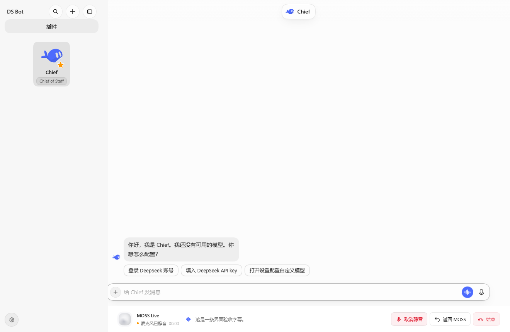
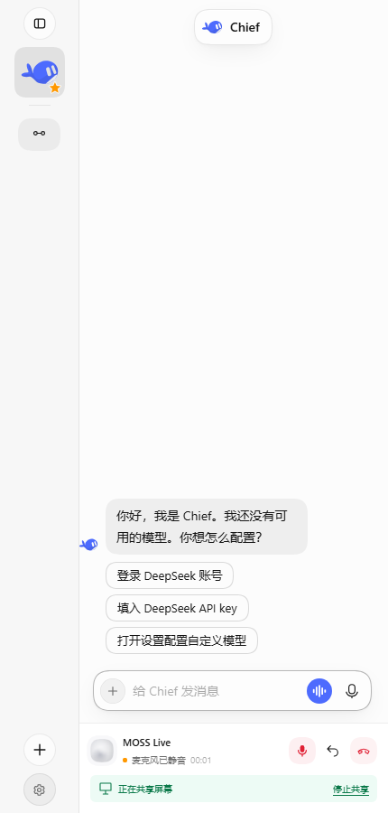
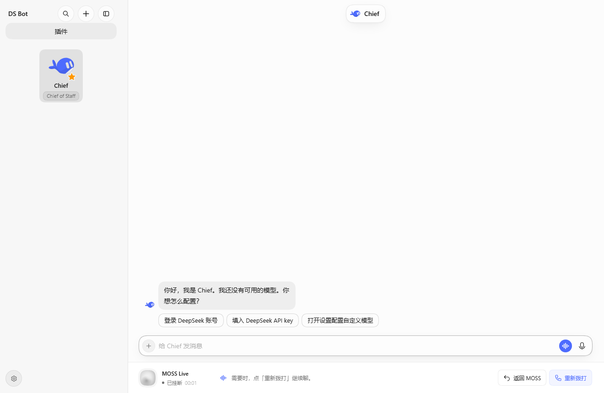
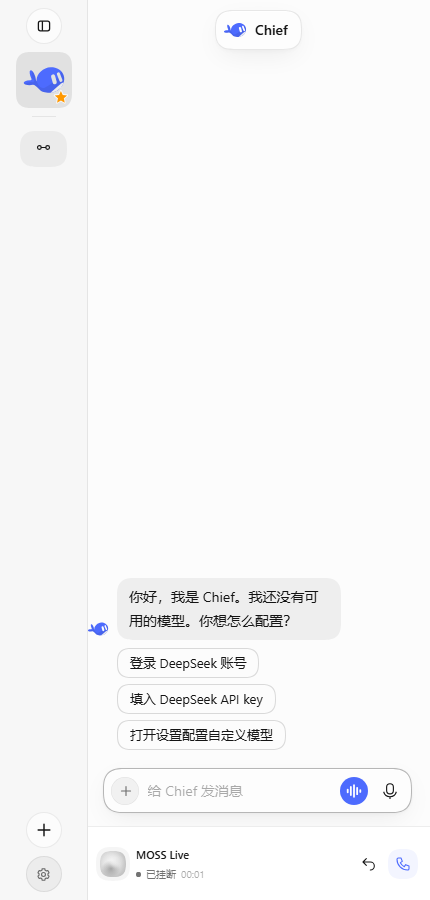

# 原型验证记录

日期：2026-11-12。范围仅为三版静态交互原型，不代表正式程序已支持跨页面保活。

- `node --check prototype.js`：退出码 0。
- 使用本仓库安装的 Electron 独立渲染，未重启正在运行的 DS Bot；原型使用单独的诊断配置目录。
- A / B / C 均验证：切换 Bot 后通话仍处于模拟运行状态；静音后返回 MOSS 保留静音和两条原字幕；停止共享不结束语音；结束同时清除共享；重新开始建立新的模拟通话并清空旧字幕。
- B 验证收起字幕后仍可展开。
- 三版均渲染 1320×860 桌面及 430×900 窄窗口，页面没有横向溢出，通话按钮在视口内。A / C 窄窗口底部控制不遮挡输入区。窄窗口静音及返回交互通过。
- 对比页三个缩略图均完成加载。渲染过程捕获的控制台错误为 0，外部/模型/API 请求为 0。
- 已查看桌面三版、窄窗口 A / C 及对比页截图。检查后修正预览状态按钮与聊天标题重叠、SVG 头像未解析主题变量的问题，并重新运行上述验证。

结构化检查结果：[verification.json](verification.json)。截图：`a-desktop.png`、`b-desktop.png`、`c-desktop.png`、对应 `*-narrow.png`、`a-return-narrow.png`、`comparison.png`。

暂不包含：真实麦克风、真实屏幕捕获、MOSS 网络会话、跨页面生产生命周期和正式插件禁用/应用退出的资源回收。这些属于视觉选定后的正式实现验收。

## 正式实现验证

2026-11-12 用户选择 A 后，验证对象改为生产代码；以上三版原型验证保留作历史。

- MOSS/插件专项：106 项通过，0 失败。
- 全量插件测试：1810 通过，1 跳过，0 失败（共 1811 项）。
- 构建和 lint 通过；lint 只包含已有警告。样式约束测试通过，未增加硬编码主题色或圆角档位。
- 新回归覆盖：页面订阅全部退出仍保留连接/字幕/静音/共享；返回设置页不再次启动；停止共享只关闭屏幕；结束与根释放清理；启动尚未完成时结束后关闭晚到中继；问候期间 ready 不能打开麦克风；取得媒体前的静音选择保留；桌面/窄窗口预留侧栏宽度，防止身份信息被覆盖。
- 用独立数据目录的真实 DSH Host、生产客户端 bundle、独立 Electron 浏览器完成实际页面操作。MOSS 上游由本机 WebSocket 模拟；输入为无声合成音轨，屏幕为标有 SYNTHETIC 的画布，不采集真实麦克风或桌面，不调用官方 MOSS 或派发真实 Bot。
- 实际点击流程：开始 → 静音 → 打开 Chief → 底部条保留 → 返回 MOSS 原标签/字幕 → 共享测试画布 → 再次离开 → 在 430 px 窗口停止共享 → 结束。全程只有 1 条模拟 MOSS 连接、1 次麦克风请求；结束后测试媒体轨道均为 ended。
- 1320×860 桌面及 430×900 窄窗口均无横向溢出；四个共享期间控制在视口内，左侧头像栏不遮挡通话身份。已查看截图并修正根插槽把 `hooks` 转为 Hook props 导致初版左侧留白失效的问题，使用显式几何数据源后重新验证通过。
- 已同步 Desktop 安装副本的客户端构建；未强制重载用户正在使用的窗口。重新加载窗口或重启应用后生效。真人说话、官方 MOSS 及真实屏幕跨页验收待用户复测。

正式代码的实际显示（模拟媒体状态）：

## 挂断后重拨验证

2026-11-12 根据用户补充要求改为普通挂断保留通话条，以下记录取代初版挂断隐藏的显示行为。

- 专项 108 项通过；全量 1812 通过、1 跳过、0 失败；构建和 lint 通过（既有警告）。
- 回归覆盖挂断保留字幕和通话条、清理完成后重拨、双击只建立一通新会话、旧事件隔离、不自动恢复共享，以及挂断清理中禁用插件立即隐藏条。
- 真实生产客户端和本机模拟 MOSS 完成两通合成媒体通话；第一次挂断后全部测试轨道关闭，仍在 Chief 页点击重拨，不必打开插件设置。第二次挂断后条仍保留，累计 2 条连接、2 次音轨请求，未重新共享屏幕。
- 已检查 1320×860 与 430×900 的挂断状态截图：显示「已挂断」及重拨入口，没有旧的静音/结束按钮，时长冻结。未使用真实麦克风、桌面、官方 MOSS 或真实 Bot 任务验证本轮变更。

